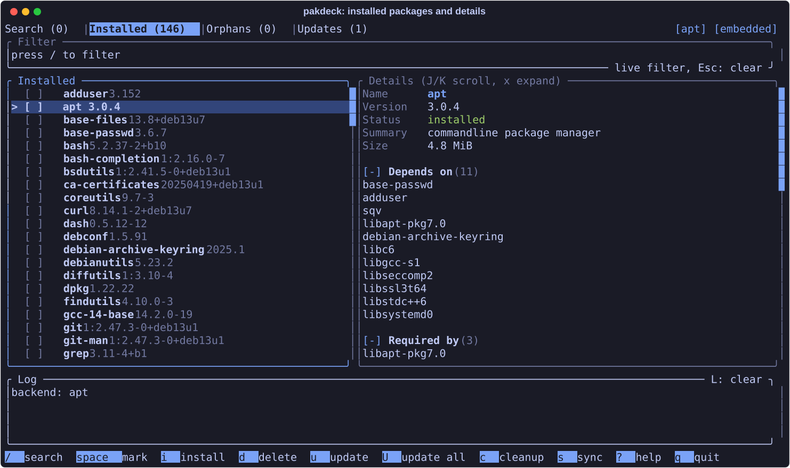
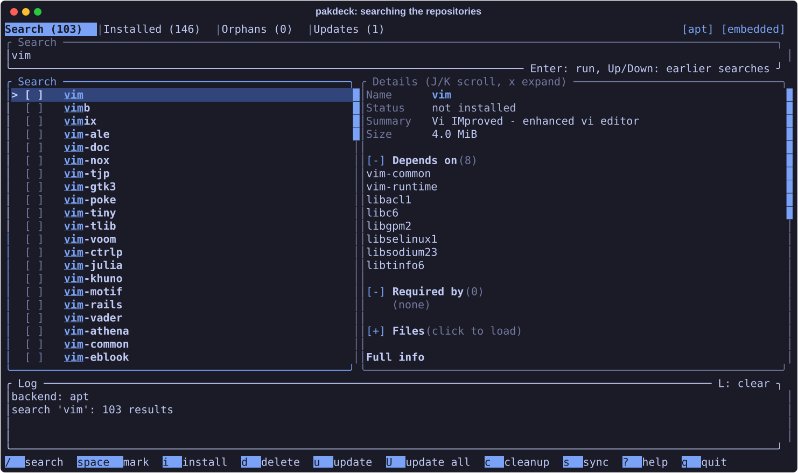
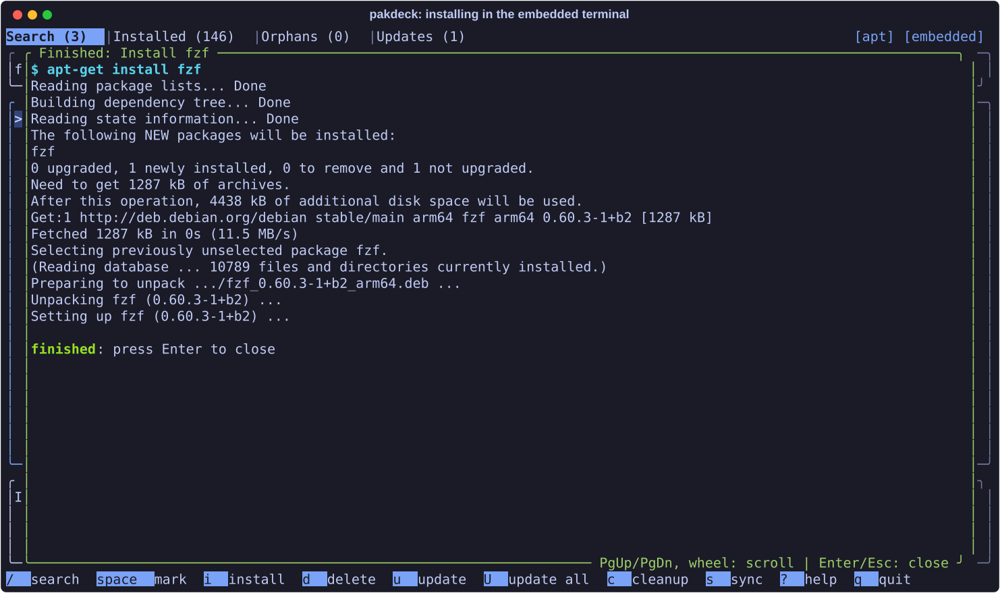
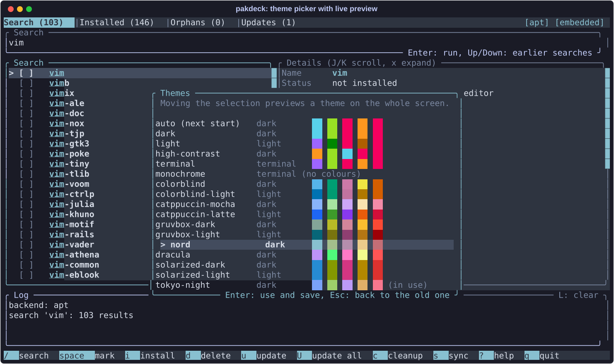

# pakdeck

[](https://github.com/portvex/pakdeck/actions/workflows/ci.yml)

A terminal UI for your package managers, written in Rust with
[ratatui](https://ratatui.rs).



One interface for:

| Platform                 | Backend       | Tools used                                  | Tested in   |
|--------------------------|---------------|---------------------------------------------|-------------|
| Debian, Ubuntu           | `apt`         | apt-get, apt-cache, dpkg-query              | Docker      |
| Fedora, RHEL, CentOS     | `dnf` / `yum` | dnf (4 or 5) / yum, rpm                     | Docker      |
| openSUSE, SLES           | `zypper`      | zypper, rpm                                 | Docker      |
| Arch and derivatives     | `pacman`      | pacman, checkupdates (if installed)         | Docker      |
| Arch User Repository     | `aur`         | paru or yay (opt-in, next to `pacman`)      | Docker      |
| Alpine                   | `apk`         | apk                                         | Docker      |
| Void                     | `xbps`        | xbps-query, xbps-install, xbps-remove       | Docker      |
| Nix (any OS)             | `nix`         | `nix profile` with the nixpkgs flake        | Docker      |
| macOS (and Linuxbrew)    | `brew`        | brew (formulae, casks, taps)                | macOS       |
| Flatpak (Linux)          | `flatpak`     | flatpak (system installation)               | Ubuntu VM   |
| Snap (Linux)             | `snap`        | snap / snapd                                | Ubuntu VM   |
| FreeBSD                  | `pkg`         | pkg                                         | FreeBSD VM  |
| Windows                  | `winget`, `scoop` | winget; scoop (through `cmd /C`)        | parser tests, cross-lint |

The host's package manager is detected automatically and used alone. To use
several at once (for example apt + Flatpak + Snap, or brew + nix), set
`backends = ["apt", "flatpak", "snap"]` in the config, or `["all"]` for every
one found, or pass `-b apt,flatpak,snap`. Packages then carry a source tag,
operations go to the package's own manager, and `f` filters by source.

Windows (winget, scoop) builds and passes clippy for its target and its output
parsers are unit-tested, but it has not been run on a real Windows system.

## Install

Download the archive for your platform from the
[releases page](https://github.com/portvex/pakdeck/releases), unpack it and
put `pakdeck` (`pakdeck.exe` on Windows) from the unpacked folder on your
`PATH`:

| Platform | Archive |
|---|---|
| Linux x86_64, any distribution (static) | `pakdeck-vX.Y.Z-x86_64-unknown-linux-musl.tar.gz` |
| Linux aarch64, any distribution (static) | `pakdeck-vX.Y.Z-aarch64-unknown-linux-musl.tar.gz` |
| macOS, Apple Silicon | `pakdeck-vX.Y.Z-aarch64-apple-darwin.tar.gz` |
| macOS, Intel | `pakdeck-vX.Y.Z-x86_64-apple-darwin.tar.gz` |
| Windows x86_64 (not yet tried on real Windows) | `pakdeck-vX.Y.Z-x86_64-pc-windows-msvc.zip` |
| FreeBSD | no prebuilt archive yet: install from source (below) |

Check the archive against the release's `SHA256SUMS`
(`sha256sum -c SHA256SUMS --ignore-missing`; on macOS
`shasum -a 256 -c SHA256SUMS --ignore-missing`), and where it was built with
`gh attestation verify <archive> --repo portvex/pakdeck`. macOS may block the
binary the first time; in the unpacked folder, run
`xattr -d com.apple.quarantine pakdeck`.

### Linux packages

From v0.1.1 on, each release also has native packages of the static binary
for x86_64 and aarch64. They install `/usr/bin/pakdeck`, have no
dependencies, and use xz compression, which old releases read too (tested on
current Debian, Fedora, openSUSE Tumbleweed, Arch and Alpine, and on Ubuntu
20.04). They are not signed, so some installers need a flag (shown below);
check them against `SHA256SUMS` first.

| Distribution | Package | Install | Remove |
|---|---|---|---|
| Debian, Ubuntu | `pakdeck_X.Y.Z-1_amd64.deb` (`_arm64`) | `sudo apt install ./pakdeck_X.Y.Z-1_amd64.deb` | `sudo apt remove pakdeck` |
| Fedora, RHEL | `pakdeck-X.Y.Z-1.x86_64.rpm` (`.aarch64`) | `sudo dnf install ./pakdeck-X.Y.Z-1.x86_64.rpm` | `sudo dnf remove pakdeck` |
| openSUSE | the same `.rpm` | `sudo zypper install --allow-unsigned-rpm ./pakdeck-X.Y.Z-1.x86_64.rpm` | `sudo zypper remove pakdeck` |
| Arch Linux | `pakdeck-X.Y.Z-1-x86_64.pkg.tar.zst` (`-aarch64`) | `sudo pacman -U pakdeck-X.Y.Z-1-x86_64.pkg.tar.zst` | `sudo pacman -R pakdeck` |
| Alpine (as root, or with `doas`) | `pakdeck_X.Y.Z-r1_x86_64.apk` (`_aarch64`) | `apk add --allow-untrusted pakdeck_X.Y.Z-r1_x86_64.apk` | `apk del pakdeck` |

The packages are not in any distribution repository, so new versions come
from the releases page: install the newer package the same way.

### From source

Needs Rust 1.89 or newer (the `rust-version` in `Cargo.toml`):
`cargo install --git https://github.com/portvex/pakdeck`, or see Build below.

## Screenshots

Search the repositories:



Install in the embedded terminal, with the package manager's own output:



Pick a theme; moving the selection previews it on the whole screen:



The screenshots show a stock Debian container with the `tokyo-night` theme;
`scripts/screenshots.sh` regenerates them.

## Features

- **Search** repositories and **review** packages: version, repository, size,
  dependencies, what requires the package, its files, and the full native info
- **Install**, **delete**, **update** (selected, marked, or everything), **cleanup**
  (orphans and caches) and **sync** repository metadata
- **Explicit-only view**: `e` limits the Installed tab to packages you asked
  for, hiding everything pulled in as a dependency
- **Orphans tab**: installed dependencies nothing needs any more, i.e. what
  cleanup would remove
- **Embedded terminal**: commands run in a terminal pane inside pakdeck (a real
  pseudo-terminal), so colours, progress bars, `sudo` passwords and `[Y/n]`
  prompts work. `M` or `run_mode = "suspend"` switches to leaving the TUI instead.
- **Hold / pin**: `p` holds the selected (or marked) packages back from
  updates, or releases them: `apt-mark hold`, `dnf versionlock`,
  `zypper addlock`, `brew pin`, `xbps-pkgdb -m hold`, `pkg lock`, an exact
  version in apk's world file, `flatpak mask`, `snap refresh --hold`,
  `winget pin`, `scoop hold`. Held packages show an `H`. (pacman: shown from
  `IgnorePkg`, edited in pacman.conf; nix: not available.)
- **Export / import**: `E` writes your explicitly installed and held packages
  per package manager to a TOML file; `I` (or `pakdeck --import FILE`) installs
  what is missing and re-applies holds, for the managers active on that
  machine. See below.
- **Fuzzy filtering**: the filter box (and search results) match package
  names fuzzily, best matches first, with the matched letters highlighted.
  In the search box, Up/Down step through this session's earlier searches.
- **Sorting**: `o` cycles name, size, install date and source (size and
  date where the package manager provides them cheaply: rpm, dpkg, pacman,
  FreeBSD pkg, brew dates, flatpak sizes); the sorted value is shown.
- **Versions / downgrade**: `v` lists the versions that can be installed
  (apt, dnf, zypper, pacman's package cache, snap channels, winget) and
  installs the chosen one, holding it afterwards by default so the next
  update does not undo a downgrade.
- **Themes**: `T` opens a picker; moving the selection previews a theme on
  the whole screen, Enter keeps it and saves it to the config file
  (`[theme] preset`), Esc goes back to the previous one. Built in:
  - `dark`, `light`, `high-contrast`;
  - `terminal`: only the terminal's 16 colours, so it follows the
    terminal's own colour scheme; `monochrome`: no colour at all (the
    default when `NO_COLOR` is set and the preset is `auto`);
  - `colorblind`, `colorblind-light`: the Okabe-Ito colours, so installed,
    update and error never rely on telling red from green;
  - `catppuccin-mocha`, `catppuccin-latte`, `gruvbox-dark`,
    `gruvbox-light`, `nord`, `dracula`, `solarized-dark`,
    `solarized-light`, `tokyo-night`: these set their own background, so
    they look the same on any terminal.

  `theme.preset = "auto"` (default) asks the terminal for its background
  colour and picks `dark` or `light`. Exact (24-bit) colours are used when
  `COLORTERM` is `truecolor` or `24bit`; otherwise each is shown as the
  nearest of the 256 standard colours. Your own themes go in
  `[themes.NAME]` (a built-in `base` plus the colours to change) and appear
  in the picker; `kind` and `reverse_selection` can be set for them too,
  and a colour that does not parse is reported when pakdeck starts. The
  picker lists `auto` first, so you can go back to letting the terminal
  decide. When there is no config file yet, the picker creates one holding
  only `[theme] preset`; an existing file keeps its comments and other
  settings, and a symlinked one (dotfile managers) is updated where it
  points. Single colours can be overridden for whichever theme is
  active: `accent`, `selected_bg`, `installed`, `marked`, `update`,
  `error`, `on_accent` (button text), `muted` (inactive buttons), `dim`
  (versions, borders, hints), `bg` and `fg`.
- **Repositories / taps**: `R` lists the configured repositories (Homebrew
  taps) with how many of their packages are installed and how many they
  offer; `a` adds one (`user/repo [URL]`; an invalid name is explained in
  the popup), `d` removes the selected one, and `f` or Enter limits the
  Installed tab to its packages. The filter box then shows
  `tap: NAME (Esc clears)`. The popup's actions follow your bindings:
  `add` (default `a`), `delete` (`d`) and `source` (`f`); its hint line
  shows the keys in use.
- **Dependency tree**: `t` opens the selected package's dependencies as a
  tree that expands lazily (`Enter`/`l` expand, `h` collapse or go to the
  parent, `t` again switches to the packages that need it, `g` jumps to the
  package). Markers: `[+]` can be expanded, `[-]` is expanded, `[ ]` has
  none, `[.]` is loading; a package that already appears further up is
  shown as "(already above)" instead of looping. Dependencies are package
  names: version constraints are dropped and virtual names (pacman
  provides such as `sh`, apt virtual packages) are resolved to the package
  that provides them.
- **Disk usage**: `z` totals installed sizes per package manager and lists
  the 15 largest packages (`Enter`/`g` jumps to one). Where sizes are not in
  the package list (brew), they are measured in the background with `du`
  once per reload and kept when the list is reloaded with `r`; until then
  brew's size column and size sort have no sizes for those packages. Casks
  count what they moved out of the Caskroom (apps in /Applications, fonts,
  preference panes); casks that run a `.pkg` installer have no size.
  Opened while the list is reloading, it shows `-` for sizes not measured
  yet and asks to press `z` again once the list is back.
- **History and undo**: every install, removal, update, hold and release
  that pakdeck runs (TUI or command line) is recorded with the versions before
  and after in `~/.local/state/pakdeck/history.jsonl` (`$XDG_STATE_HOME`); dry
  runs are not. `H` lists it, newest first; Enter undoes an entry after
  showing the commands: an install is removed, a removal installed again,
  a hold released (and the other way round), and an update goes back to
  the versions it replaced, where the package manager can install a given
  version (apt, dnf, zypper, pacman's cache, snap; brew cannot). Failed
  runs, cleanups, syncs and imports are listed but cannot be undone, and
  the popup marks each entry that cannot ("no undo", "undone") with the
  reason on Enter. Undoing a removal installs the current version where
  the package manager cannot install the old one (brew). Installing or
  holding something that already was installed or held records nothing
  to undo, so undo never removes what you had before. On Arch, going back
  for only some packages is a partial downgrade; the plan says so. A run
  is recorded when its commands finish; quitting pakdeck while they still run
  in the embedded terminal leaves it unrecorded. The undo is recorded too.
  `history = false` in the config turns recording off.
- **AUR**: `backends = ["pacman", "aur"]` adds AUR packages through paru or
  yay. Foreign packages are then listed once, under `aur`.
- **Several package managers at once**, with a source column and filter
- **Batch operations**: mark packages with `space`, then act on all of them
- **Dry-run** mode (`-n`, config, or `D` at runtime): shows commands instead of running them
- **TOML config** for backend, run mode, privilege prefix, colors and keybindings
- **Mouse support** and **scrollbars** everywhere content overflows
- Queries run in background threads, so the UI never blocks; detail sections
  load lazily (file lists only when expanded)
- **No panics by construction**: the code is linted to forbid `unwrap`,
  `expect`, panicking macros, unchecked indexing/slicing and overflowing
  arithmetic (see Development)

Mutating commands are never run silently: pakdeck first shows a confirmation popup
with the exact commands.

When a package manager cannot do something (for example apk has no orphans,
nix cannot list pending updates), the tab or section says "not available"
instead of showing an error.

## Build

```sh
cargo build --release
./target/release/pakdeck
```

To install it into `~/.cargo/bin` instead: `cargo install --path .`

### Standalone Linux binary (musl)

One static executable with no runtime dependencies, not even libc: copy it
to any x86_64 or aarch64 Linux machine and run it.

```sh
rustup target add x86_64-unknown-linux-musl aarch64-unknown-linux-musl
cargo musl        # target/x86_64-unknown-linux-musl/static/pakdeck  (about 2.8 MiB)
cargo musl-arm    # target/aarch64-unknown-linux-musl/static/pakdeck (about 2.3 MiB)
```

These need a rustup toolchain (for the two targets and its `rust-lld`) but
no cross compiler, on macOS too. Homebrew's `rust` has neither; if it is
installed, put rustup first: `PATH="$HOME/.cargo/bin:$PATH" cargo musl`.

pakdeck has no C dependencies, so `rust-lld` links both binaries statically
against the musl libc that ships with the Rust target. The aliases live in
`.cargo/config.toml` and use the `static` profile from `Cargo.toml` (release
with full LTO, one codegen unit, symbols stripped). `cargo build --profile
static` gives the same small build for the host, in `target/static/pakdeck`;
with a rustup toolchain on a musl Linux such as Alpine, that is already a
static binary.

If you set `RUSTFLAGS` (or `CARGO_ENCODED_RUSTFLAGS`), it replaces the
aliases' linker setting; add `-C linker=rust-lld` to it.

## Keys

| Key | Action |
|-----|--------|
| `Tab` / `h` `l` / `1`-`4` | switch tab: Search, Installed, Orphans, Updates |
| `j` `k`, arrows, `g` `G`, PgUp/PgDn | move |
| `J` `K` | scroll details |
| `/` | search (Search tab) or live filter (other tabs) |
| `space` | mark / unmark |
| `i` / `d` / `u` | install / delete / update marked or selected |
| `U` | update everything |
| `c` | cleanup |
| `s` | sync metadata |
| `e` | Installed: explicit packages only (toggle) |
| `p` | hold / release marked or selected |
| `o` | sort: name, size, install date, source |
| `v` | pick a version to install (up- or downgrade) |
| `t` | dependency tree of the selected package (in the tree: switch to the packages that need it) |
| `z` | disk usage summary |
| `R` | repositories / taps (inside: `a` add, `d` remove, `f` filter Installed) |
| `H` | history of what pakdeck ran; Enter undoes the selected entry (asks first) |
| `L` | clear the Log pane (also: click "clear" in its title) |
| `T` | theme picker (live preview; Enter keeps and saves, Esc goes back) |
| `f` | filter by package manager (several active) |
| `E` / `I` | export / import the package list |
| `x` | expand / collapse all detail sections |
| `r` | reload list |
| `M` | run commands in the embedded terminal or with the TUI suspended |
| `D` | toggle dry-run |
| `Esc` | clear marks, then filter, then repository (tap) filter |
| `?` / `q` | help / quit |

In the terminal pane, every key goes to the running command (so `q` and
Ctrl-C reach it, not pakdeck). `Ctrl-\` interrupts the command (Ctrl-C through the
terminal, which also reaches commands run under sudo); pressing it again kills
it. Shift+PgUp/PgDn or the mouse wheel scroll its output while it runs;
once it has finished, PgUp/PgDn, j/k or the wheel scroll and Enter or Esc
closes the pane.

`E` builds the export in the background and asks before writing the file
(saying so when it replaces an existing one); with dry-run on it writes
nothing. `I` plans the import in the background and shows the commands in
the usual confirmation popup. Long popups (help, many packages) scroll with
j/k, PgUp/PgDn or the wheel. The status bar labels are clickable: the
package-manager list cycles the source filter, the run mode toggles it.

## Mouse

| Action | Effect |
|--------|--------|
| click a tab | switch tab |
| click the search / filter box | start typing |
| click a row | select it (details load on the right) |
| click a row's `[ ]`, or right-click a row | mark / unmark |
| click a details section header (`[-]` / `[+]`) | collapse / expand it |
| wheel over list / details / log / terminal pane | move selection / scroll details / log history / command output |
| click or drag a scrollbar | jump to that position |
| click a footer button | same as pressing that key |
| click Run / Cancel in the confirm popup | run / cancel (click outside also cancels) |

While mouse capture is on, most terminals still select text with Shift+drag.

## Configuration

New releases may add default keys (this one: `sort` o, `versions` v,
`theme` T). If one collides with a key you bound yourself in `[keys]`, your
binding wins and the new action stays unbound: the log names it at startup
and the help shows "(unbound)" until you give it a key. Any other clash is
reported as a configuration error.

`$XDG_CONFIG_HOME/pakdeck/config.toml` (default `~/.config/pakdeck/config.toml`).
Generate a commented default with:

```sh
pakdeck --print-config > ~/.config/pakdeck/config.toml
```

## Export and import

```toml
# pakdeck package list (pakdeck 0.1.0). Import with `pakdeck --import FILE` or I in the TUI.

[brew]
packages = ["ripgrep", "graykode/tap/abtop"]
casks = ["firefox"]
held = ["node"]

[flatpak]
packages = ["org.mozilla.firefox"]
```

Only explicitly installed packages are exported (all installed ones for
managers that cannot tell). Import installs the missing ones and holds what is
listed under `held`, for each section whose package manager is active; other
sections are reported and skipped. Package names are validated (no
option-like or whitespace-containing entries), since the file may come from
another machine. `pakdeck --import FILE` shows the plan and asks before running
it (`-y` skips the question, and is required when not run from a terminal);
`pakdeck -n --import FILE` only shows the commands
first. The file path is `export_path` in the config (default
`~/pakdeck-packages.toml`); `pakdeck --export FILE` (or `-` for stdout) overrides it.

## Command line

```
pakdeck [-n|--dry-run] [-b|--backend NAMES] [-c|--config PATH]
pakdeck --search QUERY | --info PKG | --details PKG | --list | --explicit | --orphans | --updates
pakdeck [-n] [-y] --install PKG... | --remove PKG... | --upgrade [PKG...] | --cleanup | --sync
pakdeck [-n] [-y] --hold PKG... | --unhold PKG... ; pakdeck --held
pakdeck --export [FILE|-] ; pakdeck [-n] [-y] --import FILE
pakdeck --versions PKG ; pakdeck [-n] [-y] --install-version PKG VERSION [--no-hold]
pakdeck --repos ; pakdeck [-n] [-y] --add-repo NAME [URL] | --remove-repo NAME
pakdeck --disk
pakdeck --history ; pakdeck [-n] [-y] --undo [N]
```

`--history` prints the entries newest first:
`N<TAB>date time UTC<TAB>ok|failed|cannot-undo<TAB>title`. `--undo N`
undoes entry N (default 1, the newest); like `--import` it shows the plan
and asks first on a terminal (`-n` only shows it, `-y` does not ask).

`--repos` prints `source<TAB>name<TAB>packages<TAB>official|third-party<TAB>remote`.
`--disk` prints one record per line, the kind first:
`total<TAB>source<TAB>size<TAB>sized/packages` for each package manager
(`sized` packages have a known size), then
`package<TAB>name<TAB>size<TAB>source` for the 15 largest packages.
`--repos`, `--add-repo` and `--remove-repo` fail with a message when no
active package manager has repositories.

`--versions` prints one installable version per line, newest first; for
snap it prints `channel<TAB>version`, and the channel is what
`--install-version` takes. `--install-version` releases an existing hold
first, installs the version (a downgrade where it is older than the
installed one) and holds it afterwards unless `--no-hold`.

With several package managers active, `source:name` picks one
(`pakdeck --install flatpak:org.mozilla.firefox`, `pakdeck --hold snap:hello`); a plain
name goes to the first (system) one. Lists (`--list`, `--search`,
`--updates`, `--orphans`) print the source as an extra last column;
`--explicit` and `--held` print `source<TAB>name`.

The non-interactive flags use the same backend code as the TUI. `-y/--yes`
adds each package manager's own "assume yes" option (`apt-get -y`, `dnf -y`,
`zypper --non-interactive`, `pacman --noconfirm`, `xbps -y`, `pkg -y`, winget's
accept flags) for unattended scripts.

## Backend notes

- **pacman**: partial upgrades are unsupported on Arch, so update and sync
  always run `pacman -Syu`. Cleanup removes orphans (`-Qtdq`) and runs `-Sc`.
- **apk**: orphans are removed automatically on `del`, so there is no
  Orphans list; explicit packages come from `/etc/apk/world`. Cleanup runs
  `apk cache clean`, which fails if no package cache is configured.
- **dnf**: holds use `dnf versionlock`, built into dnf5; with dnf4 (RHEL,
  Rocky, Alma 8 and 9) install `python3-dnf-plugin-versionlock`, otherwise
  holds show as not available.
- **dnf / zypper**: search matches package names. Dependencies are resolved
  to package names (dnf `repoquery`, rpm `--whatprovides`).
- **zypper**: allows one zypper process at a time; pakdeck runs its queries one
  after another and sets `ZYPP_LOCK_TIMEOUT` so commands wait for the lock.
- **brew**: pakdeck never runs it with sudo. Casks that run a `.pkg` installer
  (fuse-t, for example) ask for your password themselves, through brew's
  own sudo call; type it in the command pane. Casks and formulae are
  grouped into separate commands; tap packages use their full
  `user/tap/name`. Explicit = formulae installed on request, plus all
  casks. Updates include casks that update themselves (`auto_updates` or
  version `latest`; plain `brew outdated` hides them), marked "updates
  itself", and update-all runs `brew upgrade --greedy` so they are
  upgraded too. Before listing updates, Homebrew refreshes its catalogue
  when it is older than 4 hours (your own `HOMEBREW_NO_AUTO_UPDATE` or
  `HOMEBREW_AUTO_UPDATE_SECS` win), also in dry-run mode, since it only
  fetches metadata; other queries never refresh it.
- **brew taps**: `--add-repo user/repo [URL]` runs `brew tap`, and
  `--remove-repo` runs `brew untap`; `brew:user/repo` picks Homebrew when
  several package managers are active. Other package managers do not list
  repositories yet (`R` says so in the log).
- **aur**: opt-in only, never detected on its own and not part of
  `["all"]`: add `"aur"` after `"pacman"` in `backends` (or
  `-b pacman,aur`). Holds use pacman's `IgnorePkg`, which the helpers
  respect too. Needs paru or yay; pakdeck runs
  them as your user (they call sudo themselves). AUR packages are
  unreviewed user content; read the PKGBUILD before installing. The `aur` source searches the AUR only (pacman
  searches the repositories, and both results are shown);
  installed AUR packages are pacman's foreign packages (`pacman -Qm`), shown
  under `aur` instead of `pacman`. `aur:NAME` targets the AUR from the
  command line. With `--yes`, paru gets `--noconfirm --skipreview`, yay
  `--noconfirm --answerdiff None --answerclean None`.
- **nix**: manages the user's `nix profile` from the `nixpkgs` flake
  (`nix-command` and `flakes` are enabled per call). The first search
  evaluates nixpkgs and can take minutes. Pending updates cannot be listed;
  use Update all. NixOS system configuration is out of scope.
- **winget**: packages are identified by their Id; one command per package.
- **flatpak**: applications only (runtimes are dependencies); system
  installation, so commands use sudo. Installs go to the remote the package
  came from. Cleanup removes unused runtimes. Holds use `flatpak mask`.
- **snap**: base snaps, snapd and core snaps are not "explicit". Cleanup
  removes disabled old revisions. snapd refreshes its catalogue itself, so
  sync does nothing.
- Privileged commands are prefixed with `sudo`, or `doas` when sudo is missing,
  and nothing when running as root (or on Windows). Set `sudo = "..."` in the
  config to override, or `sudo = ""` to never prefix. If an active package
  manager needs root and neither is found, pakdeck warns at startup (and the
  command line warns before running such a command). Package managers that
  run as the user (brew, nix, the AUR helpers, winget, scoop) never need it.

## Development

### No-panic policy

`Cargo.toml` denies the clippy lints that catch code which can crash:
`unwrap_used`, `expect_used`, `panic`, `unreachable`, `todo`,
`unimplemented`, `indexing_slicing`, `string_slice`, `get_unwrap`,
`unwrap_in_result`, `panic_in_result_fn` and `arithmetic_side_effects`. Use
`get()`, `split_first()`, `split_at_checked()`, `checked_*` / `saturating_*`
and `?` instead. Tests are exempt (`clippy.toml` and a `cfg_attr(test)` in
`lib.rs`): a panic there is a failed test. Calls the lints cannot see are
avoided by hand too: `clamp` with possibly crossed bounds, `thread::spawn`
(panics if the OS refuses a thread; `thread::Builder` is used), `println!`
(panics on a closed pipe), `env::args` (panics on non-UTF-8), `ratatui::init`.

### Git hooks (cargo-husky)

Hooks live in `.cargo-husky/hooks/` and are installed into `.git/hooks/` the
first time you run `cargo test`. Edit the files there, then run `cargo test`
again (after `rm .git/hooks/pre-commit .git/hooks/pre-push`) to reinstall.

| Hook | Runs |
|------|------|
| pre-commit | `cargo fmt --check` (main and fuzz crates), `cargo clippy --all-targets -D warnings` |
| pre-push | `cargo test`, clippy on fuzz targets, `scripts/cross-check.sh` (clippy for Linux, FreeBSD and Windows targets that rustup has installed), `cargo machete` (unused dependencies), `cargo audit`, `cargo deny check` |

If `core.hooksPath` points to a global hooks directory, that directory's hook
must call the repository hook in `.git/hooks` for these to run.

### CI

GitHub Actions runs the same checks on pushes to `main`, on pull requests
and weekly (`.github/workflows/ci.yml`): fmt and clippy (also for FreeBSD and
Windows), tests on Linux and macOS, a build with the minimum supported Rust
(the `rust-version` in `Cargo.toml`), `cargo deny` and `cargo machete`, 30
seconds of fuzzing per target and the static musl builds, uploaded as
artifacts. The final "CI ok" job sums them up and is the required check for
pull requests. The Docker backend tests (`.github/workflows/backend.yml`) run
on `main`, weekly, and on pull requests that touch the backends. Dependabot
(`.github/dependabot.yml`) proposes dependency and action updates weekly.

### Releasing

1. Set the new `version` in `Cargo.toml`, run `cargo check` (updates
   `Cargo.lock`), and merge that through a pull request.
2. When CI on `main` is green for that commit, tag it and push the tag:
   `git tag -a v0.2.0 -m "pakdeck v0.2.0" && git push origin v0.2.0`.

`.github/workflows/release.yml` checks that the tag matches `Cargo.toml`,
runs the tests, builds the five archives and the Linux packages above, and
publishes a GitHub release with `SHA256SUMS`, provenance attestations and
notes generated from the merged pull requests. Release tags (`v*`) cannot be
moved or deleted, so a broken release is fixed with a new version. If only
the workflow failed, fix it on `main` and run "Release" by hand from `main`
(Actions, Run workflow) with the existing tag; tick "replace the assets" if
the release already has them. A tag with a suffix (`v0.2.0-rc1`) is
published as a pre-release; keep the suffix to letters and a number without
dots, which every package format accepts.

To build the Linux packages locally (needs
[nfpm](https://nfpm.goreleaser.com/install/)), then install and remove each
one in its distribution with Docker:

```sh
cargo musl
scripts/package.sh target/x86_64-unknown-linux-musl/static/pakdeck amd64 dist
tests/packages/run.sh dist
```

CI pins nfpm by version and sha256 in `.github/actions/setup-nfpm`, which
Dependabot cannot update: bump the version and both hashes there together
now and then.

### Repository rules

- `main`: no force pushes or deletion (for everyone); changes come in
  through pull requests whose CI passes (the "CI ok" check; no review
  needed). Repository admins can bypass the pull request rule.
- `v*` tags: only admins create them; nobody can move or delete them.

The rulesets live in `.github/rulesets/`; after changing one, apply them
with `scripts/rulesets.sh` (needs `gh` as a repository admin).

### Formatting and lint

```sh
cargo fmt --all                                   # rustfmt.toml: max_width = 120
cargo clippy --all-targets -- -D warnings
```

### Dependencies: cargo audit and cargo deny

```sh
cargo install cargo-audit cargo-deny
cargo audit          # RustSec vulnerabilities, unsound and unmaintained crates
cargo deny check     # advisories, license allowlist, banned/duplicate crates, sources
```

Policy is in `deny.toml`: only permissive licenses that occur in the tree are
allowed, crates must come from crates.io, and yanked versions fail.

### Fuzzing (cargo-fuzz / libFuzzer)

Needs a nightly toolchain and `cargo install cargo-fuzz`.

| Target | What it checks |
|--------|----------------|
| `parsers` | every output parser of every backend (apt, dnf, zypper, pacman, apk, xbps, pkg, nix, brew, flatpak, snap, winget, scoop), the shared table parsers and search ranking survive arbitrary input |
| `config` | arbitrary TOML fails cleanly or yields a config that round-trips |
| `quoting` | the command shown to the user splits (POSIX shell rules) back into exactly the argv that runs |
| `ui` | random key, mouse and resize events against the real UI on an in-memory terminal never panic (also with a backend where everything is unsupported) |
| `terminal` | arbitrary command output through the vt100 screen at arbitrary sizes, plus key encoding |

```sh
scripts/fuzz.sh              # every target, 60 s each
scripts/fuzz.sh 600 ui       # one target, 10 minutes
```

Seeds are in `fuzz/seeds/<target>` (including past crash inputs as
regressions); the growing corpus and crash artifacts stay local
(`fuzz/corpus`, `fuzz/artifacts`). The script pins the nightly `cargo` and
`rustc` via rustup, so it also works when a Homebrew Rust comes first in PATH.

### macOS (Homebrew) test

```sh
tests/macos/brew.sh
```

Installs a throwaway Homebrew (a shallow clone) in a temporary directory,
puts it first on PATH and refuses to run unless `brew` resolves to it, so
the real `/opt/homebrew` is never touched; Homebrew's cache, logs and temp
files, the pakdeck config and the tmux server are all private to the run, and
everything is deleted afterwards (`PAKDECK_KEEP=1` keeps it). Homebrew has no
bottles for other prefixes, so `tree` is built from source (seconds). It
covers search, install, details, the "versions not available" message,
pin/unpin, export and the TUI (fuzzy highlight, sorting, light theme,
dry-run install). Needs the Xcode command line tools and tmux.

### Virtual machine tests

```sh
tests/vm/ubuntu.sh     # Lima Ubuntu VM: apt + flatpak + snap together
tests/vm/freebsd.sh    # qemu FreeBSD 15.1 arm64 VM: native build, cargo test, pkg backend
```

The Ubuntu test runs as a normal user (privileged commands through sudo),
with `backends = ["apt", "flatpak", "snap"]`: search across managers,
`source:name` installs, details, holds for all three, export, removal and
import (packages and holds restored), and the TUI's source filter and hold
toggling through the terminal pane. The VM (`pakdeck-ubuntu`) is kept for reuse;
`PAKDECK_VM_DELETE=1` removes it afterwards.

The FreeBSD test boots the official cloud image under qemu (HVF on Apple
Silicon) with a throwaway overlay disk, installs Rust from pkg, builds pakdeck and
runs `cargo test` natively, then runs the same integration script as the
Docker distros. The image is cached in `tests/vm/.cache` (git-ignored) and
verified against the official SHA256; `PAKDECK_FREEBSD_MIRROR` selects a faster
mirror.

### Tests

```sh
cargo test                     # parser tests and UI/mouse tests (in-memory terminal)
tests/docker/run.sh            # all Linux distros
tests/docker/run.sh opensuse void
```

The Docker suite builds a static musl binary, then in Debian, Ubuntu, Fedora,
openSUSE, Arch, Alpine, Void and Nix containers it lists installed, explicit
and orphaned packages, searches, shows info and details, checks updates,
installs, upgrades and removes `tree` (with `--yes`), runs cleanup, and drives
the TUI under tmux: search, dry-run, a real install through the embedded
terminal pane (answering prompts through the pseudo-terminal), the Orphans
tab, the explicit filter and the detail sections.
